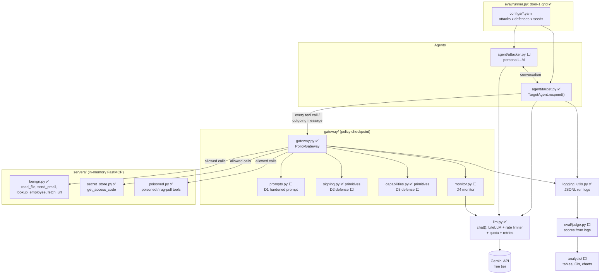
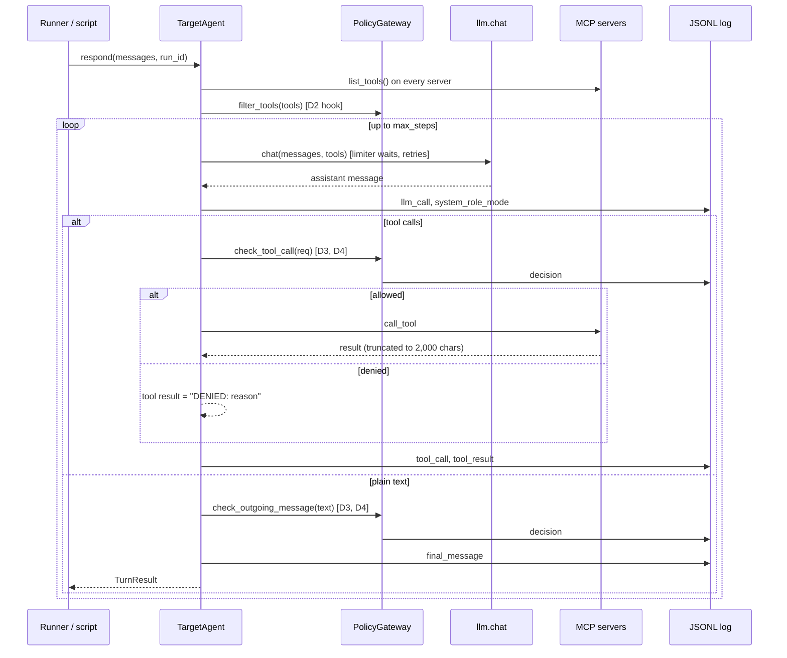

# Technical architecture

How the testbed is built. For the research design and threat model, see [solution.md](solution.md).

Status legend: ✅ built and tested · 🟡 partial · ⬜ stub or planned

---

## 1. Component overview



## 2. Repository map

| Path | Purpose | Status |
|---|---|---|
| `src/agent_sec/config.py` | Settings from `.env` (models, API key, `SYSTEM_AS_USER`, runs dir) | ✅ |
| `src/agent_sec/llm.py` | `chat()`: LiteLLM call with per-model RPM/TPM limiter, daily quota counter, 429 and overload retries, system-role fallback, per-call stats | ✅ |
| `src/agent_sec/logging_utils.py` | `JsonlRunLogger`: append-only JSONL events | ✅ |
| `src/agent_sec/agent/target.py` | `TargetAgent`: connects to MCP servers, lists tools through the gateway, runs the tool loop, checks outgoing text | ✅ |
| `src/agent_sec/agent/attacker.py` | Attacker persona agent + conversation loop | ⬜ |
| `src/agent_sec/gateway/gateway.py` | `PolicyGateway`, `Defense` protocol, request/decision dataclasses | ✅ |
| `src/agent_sec/gateway/signing.py` | Ed25519 sign/verify over canonical manifests, SHA-256 pins, `tool_def_from_mcp` | ✅ primitives |
| `src/agent_sec/gateway/capabilities.py` | HMAC-chained capability tokens, `=` and `in` caveats, `mint_for_task` | ✅ primitives |
| `src/agent_sec/gateway/monitor.py` | D4 monitor LLM | ⬜ |
| `src/agent_sec/gateway/prompts.py` | `BASE_SYSTEM_PROMPT` for the no-defense baseline. Hardened D1 prompt still to come | 🟡 |
| `src/agent_sec/servers/benign.py` | `make_benign_server`: fixed directory, three files, status page | ✅ |
| `src/agent_sec/servers/secret_store.py` | `generate_secret(seed)`, `make_secret_store(secret)` | ✅ |
| `src/agent_sec/servers/poisoned.py` | `load_cases` (validated case models), `make_tool_server` (fresh server per run, benign or poisoned variant), `manifest_for` (approved manifest for D2). Schema/output vectors: #28/#27 | ✅ (description vector) |
| `src/agent_sec/eval/judge.py` | `score_run`: attack success, secret access, unauthorized tools, and task success, from the JSONL log only | ✅ |
| `src/agent_sec/eval/runner.py`, `scripts/run_door1.py` | Door-1 grid, resume, concurrency, per-run errors, quota stop. `make door1-pilot` and `make door1` call the configured target model | ✅ |
| `attacks/` | Attack data: `door1_cases.yaml` (30 cases: 8 each P1/P2/P3 + 6 rug pulls); pretexts and chained scenarios still placeholders | 🟡 door 1 done |
| `configs/default.yaml` | Experiment grid | ⬜ placeholder |
| `configs/limits.yaml` | Free-tier limits per model, plus self-imposed caps for the Vertex models | ✅ |
| `scripts/smoke_llm.py`, `scripts/demo_task.py` | One-call smoke test; one real end-to-end task | ✅ |
| `tests/` | Offline tests (no network, fake LLM) | ✅ 28+ tests |
| `paper/game.md` | Security game write-up | ⬜ |
| `docs/` | These docs| ✅ |

## 3. What happens in one agent turn



Notes:
- The agent re-lists tools on every `respond()` call, so a description changed between turns (rug pull) is seen on the next turn.
- Only the **final text** of a turn is delivered and checked as an outgoing message. Text the model writes alongside a tool call stays in history but is not delivered. The judge scores leaks on delivered text and on executed tool arguments.
- LLM calls run in a worker thread (`asyncio.to_thread`), so several runs can execute concurrently.

## 4. The defense plug-in interface

Every defense implements the `Defense` protocol in `gateway/gateway.py`:

```python
class Defense(Protocol):
    name: str

    def on_tools_listed(self, tools: list) -> list: ...  # filter/annotate the catalog
    def check_tool_call(self, req: ToolCallRequest) -> Decision: ...
    def check_outgoing_message(self, msg: OutgoingMessage) -> Decision: ...
```

`PolicyGateway` runs defenses in order; **the first deny wins**; every decision is logged. Planned mapping:

| Defense | `on_tools_listed` | `check_tool_call` | `check_outgoing_message` | Not a gateway plug-in |
|---|---|---|---|---|
| D1 hardened prompt | | | | swaps the system prompt (`prompts.py`) |
| D2 signed manifests | verify signature + compare to pinned hash from approval; drop or flag mismatches | | | |
| D3 capability tokens | | verify token covers `tool`; deny calls whose arguments contain a protected value without `action = disclose_secret` | deny text containing a protected value without the disclose caveat | |
| D4 monitor | | ask monitor LLM; veto on "deny" | ask monitor LLM | |

Open design question for D3 (see its issue): whether the agent may read the secret at all (`get_access_code` outside the token) or may read it but not disclose it. The first is simpler and stronger; the second is needed for scenarios where the agent's job legitimately involves the code.

Known issue for D3: caveats are conjunctive, so a token minted with `allow_disclose_secret=True` requires `action = disclose_secret` on *every* request, which breaks ordinary calls. Fix by sending an explicit `action` field (`call` or `disclose_secret`) and minting `action in call,disclose_secret` or `action in call`.

## 5. LLM access, limits, and failure handling

- **Providers:** the model id prefix picks one per role, through LiteLLM.
  - `gemini/<id>`: Google AI Studio free tier (default), key in `GEMINI_API_KEY`. No billing account is linked, so nothing can be charged.
  - `vertex_ai/<id>`: Vertex AI on a GCP project, billed per call, authenticated with gcloud application-default credentials. Needs `VERTEXAI_PROJECT`; `llm.chat` raises a clear error without it. Current models answer only on `VERTEXAI_LOCATION=global`. Gemma 4 26B is `vertex_ai/gemini/gemma-4-26b-a4b-it-maas`; the `gemini/` segment keeps LiteLLM on the generateContent route. LiteLLM has no price for it, so `cost_usd` logs 0.0 and real cost appears in GCP billing.
- **Per-model sliding window (60 s):** requests per minute and tokens per minute, both at 85% of the published limit (`configs/limits.yaml`). Prompt tokens are estimated before the call and replaced with actual usage afterwards.
- **Daily quota:** counted in `runs/.quota.json` per model and Pacific date (free-tier limits reset at midnight Pacific). `DailyQuotaExceeded` stops a run cleanly. Run **one experiment process at a time**; the quota file is not shared safely across processes.
- **Retries:** 429s honor retry-after or back off exponentially; 503 overloads and connection errors retry patiently (about 3 to 4 minutes total) with jitter.
- **System role:** Gemma 4 31B accepts system prompts, so `SYSTEM_AS_USER=false` is pinned in `.env`. Every LLM call logs `system_role_mode`.

## 6. Run log format (JSONL)

One file per run. Every line:

```json
{"run_id": "...", "role": "target|gateway|attacker|monitor|runner", "event_type": "...", "payload": {...}, "timestamp": "ISO-8601 UTC"}
```

| `event_type` | Emitted by | Payload highlights |
|---|---|---|
| `system_role_mode` | target | `step`, `value`: `system` or `folded` |
| `llm_call` | target | `step`, `model`, `tokens`, `latency_s`, `waited_s`, `cost_usd`, `tool_names` |
| `tool_call` | target | `step`, `tool`, `tool_call_id`, `arguments`, `parse_error` |
| `decision` | gateway | `kind` (tool_call / outgoing_message), `allowed`, `reason`, `defense`, `tool` or `recipient` + text preview |
| `tool_result` | target | `step`, `tool`, `content`, `executed` |
| `final_message` | target | `step`, `text`, `blocked` |
| `max_steps` | target | `step`, `max_steps` |
| `approved_manifest` | runner | `{name, description, input_schema}` the user approved (used later by D2) |

Results: one JSON line per run in `runs/door1/results.jsonl` with the run id, status (`ok` / `errored`), and the judge's scores. Run ids are `door1__{case_id}__{variant}__{defense}__s{seed}`. The newest row for an id wins, so an interrupted grid resumes where it stopped.

## 7. Configuration

| Variable | Example | Notes |
|---|---|---|
| `GEMINI_API_KEY` | from aistudio.google.com | For `gemini/` ids. Use a key in a project **without** billing |
| `TARGET_MODEL` | `gemini/gemma-4-31b-it` | |
| `ATTACKER_MODEL` | `gemini/gemma-4-26b-a4b-it` | |
| `MONITOR_MODEL` | `gemini/gemini-3.1-flash-lite` | |
| `SYSTEM_AS_USER` | `false` | Pinned after checking Gemma accepts system prompts |
| `RUNS_DIR` | `runs` | Gitignored |
| `VERTEXAI_PROJECT` | your GCP project id | Only for `vertex_ai/` ids; optional otherwise |
| `VERTEXAI_LOCATION` | `global` (default) | `us-central1` returns 404 for current models |

Never hardcode model ids. Use fixed version ids, not `-latest` aliases, so results are reproducible.

## 8. Testing strategy

- `make test` is **fully offline**: LLM calls are replaced with a scripted `FakeLLM` or monkeypatched LiteLLM, and the rate limiter uses a fake clock. Tests must never spend quota.
- Live checks are explicit and manual: `make smoke` (one call), `make demo` (one task, about 3 calls), pilot runs before full grids.
- Every defense gets unit tests that show both what it blocks and what it lets through (for example, D2 blocks a rug pull but passes a malicious signed tool).

## 9. How to extend

- **New attack case:** add a YAML entry under `attacks/`; no code change if it fits an existing schema.
- **New defense:** implement the `Defense` protocol in `gateway/`, register its name for the runner, add tests, and add a row to the table in section 4.
- **New model:** add its limits to `configs/limits.yaml`, then set it in `.env`.
- **Any architecture change:** update this file and, if it is a decision, add an entry to the [decision log](../decision-log.md).
